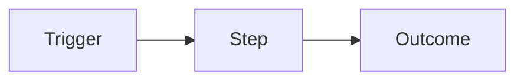
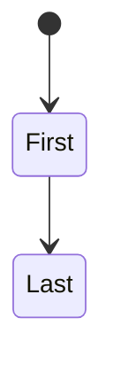

# [Context name] — Bounded context

> Reconstructed from the codebase at [commit / date]. Analysis mode: [complete context / repository atlas]. Scope: the **[context]** bounded context within the wider product. Complements `../BUSINESS_OVERVIEW.md` and `../TECHNICAL_DOMAIN_GUIDE.md` — does not replace them.
> Register: business language. Rules, concepts, and terms are referenced by ID (`R-001`, `C-001`); the `path:line` evidence for each ID lives in `../TECHNICAL_DOMAIN_GUIDE.md`.
> **Discovery boundary:** [Modules and deployables owned by this context.] **Sampled or excluded:** [Areas of this context intentionally not read and why.] **Confidence limits:** [Missing tools, unavailable contracts, or facts that could not be established from this context.]

## Why this context exists

[The business problem this bounded context solves, in business language — only if the repository establishes it. Otherwise record the observable fact (what it does) and list the purpose under § What this context does not establish.]

## Concept index (this context)

[Every concept this context owns, complete. One line each; depth lives below.]

| ID | Concept | One-line meaning |
|---|---|---|
| C-101 | [Concept] | [One-line meaning] |

## The main concepts

For each concept, the same five-question test as `../BUSINESS_OVERVIEW.md` § The main concepts applies — definition grounded in observed behavior, attributes and shape in the code's words, relationships with other concepts (in this context and across boundaries), processes it participates in, and why a newcomer must understand it.

A glossary of one-liners belongs at the end of the document; this section is where the model gets built. The breadth here is what the context owns — not a slice of the wider product.

### [Concept]

**What it is.** [...]

**Attributes and shape.** [...]

**Relationships with other concepts.** [For each relationship, name it specifically: in-context, or cross-context. Cross-context edges name the destination context explicitly.]

**Processes it participates in.** [...]

**Why a newcomer must understand it.** [...]

## Process catalog (this context)

[Every material process this context participates in. Cross-context processes name the other contexts involved.]

| ID | Process | Actor | Trigger | Outcome | Contexts crossed |
|---|---|---|---|---|---|
| P-101 | [Name] | [Who starts it] | [What starts it] | [What the business gets] | [other contexts, or "none"] |

## How the value flows in this context

[Narrate in business terms: who triggers the flow, what has to be true along the way, what the business gets. Include the failure and exception paths that change the outcome.]

## Lifecycles

[One subsection per entity in this context that has a meaningful state. For each: states, transitions, who moves them, which transitions the system explicitly rejects, and which have no code behind them (absence, not prohibition).]

### Life of a [entity]

## Invariants specific to this context

| ID | Rule | Failure mode |
|---|---|---|
| R-101 | [What must hold] | [What happens when violated] |

[State only rules that are specific to this context. Rules shared across contexts belong in `../BUSINESS_OVERVIEW.md` § The rules of the game; reference them from here by ID rather than duplicating. The evidence for each ID lives in `../TECHNICAL_DOMAIN_GUIDE.md` § Invariants and business rules.]

## Vocabulary (this context)

| ID | Term | Means | Also called |
|---|---|---|---|
| T-101 | [Term] | [One-line definition] | [Alias in the interface or in the code] |

[Context-scoped terms only. The product-wide glossary is in `../BUSINESS_OVERVIEW.md` § Vocabulary; the code-level mapping with evidence is in `../TECHNICAL_DOMAIN_GUIDE.md` § Glossary (code ↔ business).]

## Risks specific to this context

Things a new joiner working in this context should know before their first change. Reference the evidence by ID; the `path:line` lives in `../TECHNICAL_DOMAIN_GUIDE.md` § Risks and observations.

- **BLOCKER — [Observation]** — [ID]. [Why it is a blocker.]
- **RISK — [Observation]** — [ID]. [Why it is a risk.]
- **SMELL — [Observation]** — [ID]. [Why it is a smell.]

[Context-scoped risks only. Product-wide risks live in `../TECHNICAL_DOMAIN_GUIDE.md` § Risks and observations.]

## Related contexts

| Context | File | Relationship |
|---|---|---|
| [Name] | [`<other>.md`](<other>.md) | [Reads from / writes to / triggered by / …] |
| Product overview | [`../BUSINESS_OVERVIEW.md`](../BUSINESS_OVERVIEW.md) | This context is one part of what the business overview describes. Cross-reference it for any rule or concept that crosses boundaries, and for the "Three things that would surprise a newcomer". |
| Code map | [`../TECHNICAL_DOMAIN_GUIDE.md`](../TECHNICAL_DOMAIN_GUIDE.md) | The evidence for every rule, concept, and term ID used in this document lives there. |

When per-context files exist, every entry above links back to this section from its own "Related contexts", so navigation works in both directions.

## What this context does not establish

[Information absent from the repository, specific to this context. Same discipline as the overview document: describe the absent fact and where the absence was observed; do not ask the reader to resolve code inconsistencies.]
