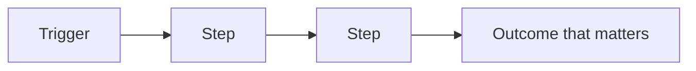
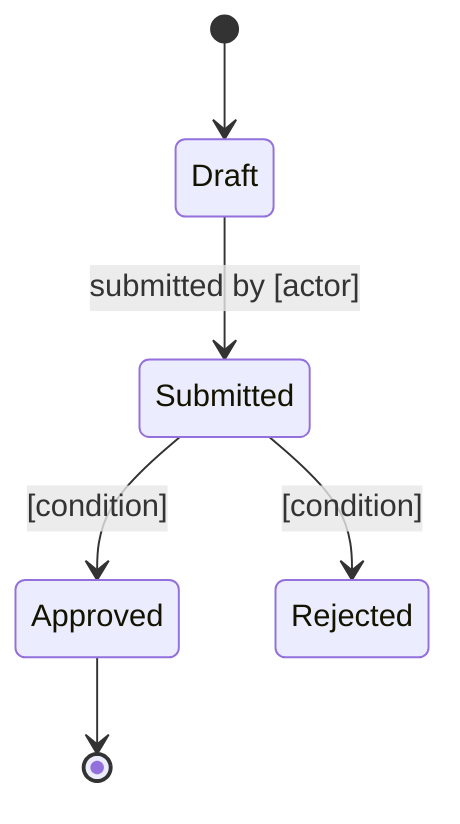

# [Product name] — What this system does

> Reconstructed from the codebase at [commit / date]. Analysis mode: [complete context / repository atlas]. This document describes observed behavior only; interpretive claims are labelled as synthesis. Inconsistencies and ambiguities found in the code are recorded as observations, not as questions for the reader to resolve.
> **Discovery boundary:** [Bounded contexts and products analyzed.] **Sampled or excluded:** [Areas intentionally not read and why — atlas mode only.] **Confidence limits:** [Missing tools, unavailable contracts, or facts that could not be established from the repository.]
> This document uses business language. Every rule and concept has an ID (`R-001`, `C-001`); the technical evidence for each ID lives in `TECHNICAL_DOMAIN_GUIDE.md`.

## Three things that would surprise a newcomer

[Three observed findings — drawn from the code, not inferred — that contradict what a reasonable reader would assume before opening the code. Each states what is surprising, why it is surprising, and references the evidence by rule ID. Hard cap at three; longer lists become decoration.]

*Example:*
1. *The "Submit" button does not send the claim to the insurer.* *It only enqueues the claim for Acme's internal review; nothing at that step contacts the insurer.* (R-003)
2. *"Reject" means two different things in the same flow.* *Internal-review rejections and insurer rejections share one exception but require different downstream handling; the email template currently treats them identically.* (R-011)
3. *A claim can be marked Paid in the database even if the service-layer guard is bypassed.* *The service guard and the database constraint reject different transitions — either side can be patched without the other noticing.* (R-007)

## In one paragraph

[What the product does, for whom, and the problem it removes — only if the repository establishes these. Plain language, no technical terms. Do not state market size, customer counts, or commercial model unless the repository documents them. If someone reads only this paragraph, they should be able to describe the product in a meeting.]

*Example —* *Acme Claims is a web platform that lets hospital billing teams submit, track, and contest insurance claims. It centralizes insurer responses and surfaces the ones that need a human reply.*

## Who uses it

[Include human roles, automated actors (schedulers, consumers), and external systems that act on this product.]

| Actor | What they do here | What they cannot do |
|---|---|---|
| [Role] | [Their main actions] | [Meaningful restrictions] |

*Example —*
| *Hospital biller* | *Files claims, replies to insurer objections, exports monthly reports.* | *Cannot approve payouts or change fee schedules.* |
| *Acme reviewer* | *Approves contested claims, sets review priorities, escalates SLA breaches.* | *Cannot impersonate a biller in the portal.* |
| *Nightly reconciliation job* | *Re-reads insurer responses and flags claims whose state diverges.* | *Cannot change claim state; it only raises review tasks.* |

## Concept index

[Every domain concept found, complete — this table is the coverage artifact. One line each; depth lives in the next section or in the per-context file.]

| ID | Concept | One-line meaning | Told in depth at |
|---|---|---|---|
| C-001 | [Concept] | [One-line meaning] | [§ The main concepts / domains/<context>.md] |

## The main concepts

The four to eight ideas that organize the product, chosen from the concept index. **Do not settle for a one-line definition per concept.** For each one, the section must be deep enough that a newcomer can answer four questions without rereading the code: *what is this thing, what does it look like in this product, what happens when it changes or disappears, and what would a newcomer get wrong without it?* If any of those four is missing, the subsection is not done.

Length here is not a constraint — depth is the deliverable. A glossary of one-liners belongs at the end of the document; this section is where the model gets built.

Cover for each concept:

- A definition grounded in observed behavior, not inferred intent.
- Its attributes and shape, using the terminology the code actually uses. If the UI, the docs, and the database use different names for the same thing, record all of them without deciding which is correct.
- Its relationships with the other concepts in this section, named specifically (one-to-many, belongs-to, triggers, blocks) — never "related to".
- The business processes it participates in, end to end, with the actors involved and the outcome of each participation. A process is not a CRUD operation; it is a workflow with a non-trivial business meaning.
- A short "why a newcomer must understand it" — the decisions a new joiner will make in their first weeks that pivot on this concept.

Use the code's observed terminology. If the interface and the implementation use different names, record both. If the codebase hides a concept the docs never name (a column, a status, a service that appears in no spec), surface it here anyway — its absence from the docs is a finding.

### [Concept]

**What it is.** [Definition based on observed behavior. State what a fresh instance looks like, what changes about it over time, and what happens if it disappears from the system. Do not state why it exists unless the repository explicitly documents that reason.]

**Attributes and shape.** [The fields, states, components, or invariants it carries. Use the names the code uses; if the UI or the business language uses different ones, record both. State units, ranges, and enums verbatim.]

**Relationships with other concepts.** [For each related concept, name the relationship specifically and what it means in business terms. Note which relationships are asymmetric, which are optional, and which the code enforces vs. merely implies.]

**Processes it participates in.** [For each process, name the actor, the trigger, and the outcome. If the concept has a lifecycle, describe each transition and who moves it forward; if it is passive, describe the events that read or write it.]

**Why a newcomer must understand it.** [What decisions a new joiner will make in their first weeks that depend on this concept, and what they will get wrong without the mental model. Frame this in business terms, not code terms.]

*Example — Claim.*

*What it is.* A request for reimbursement a hospital sends to an insurer. Each Claim starts as a draft, moves through review, and ends either paid or rejected. After rejection it is not edited in place — a new Claim is filed with corrections — so the lifecycle is forward-only with rejection as a terminal state that may seed a successor.

*Attributes and shape.* A status (Draft, Submitted, In Review, Paid, Rejected), a hospital, an insurer reference, a 48-hour review deadline measured from the moment the reviewer is assigned, a single reviewer assigned for the duration of the claim, and a monetary amount stored in cents and rendered as dollars in the UI. The status field drives nearly every branch in the system; "Rejected" is two distinct enum values that downstream code treats differently (see § Terminology traps).

*Relationships with other concepts.* A Claim belongs to exactly one Hospital and one Insurer. It has zero or one assigned Reviewer (mandatory once Submitted; never swapped after Paid). It owns zero or many ReviewEvents — append-only records of who did what and when. On Paid, it generates exactly one Payment and one line on the Hospital's monthly Invoice. On Rejected, it does not mutate itself: a new Claim is filed with corrections, and the original is archived for audit.

*Processes it participates in.*

- *Submission* — a Hospital biller files the Claim from the portal; the system assigns a Reviewer and starts the 48h clock.
- *Review* — the assigned Reviewer moves the Claim from Submitted to In Review to Paid or Rejected within 48h; missing the deadline escalates to a human but does not auto-decide.
- *Payout* — on Paid, the Claim triggers a Payment and a line on the Hospital's monthly Invoice.
- *Contention* — on Rejected, the Claim returns to the biller with the rejection reason attached; a new Claim may be filed with corrections.
- *Audit* — every status transition writes a ReviewEvent; the Claim is the root of the audit trail.

*Why a newcomer must understand it.* Pricing, deadlines, notifications, audit logs, and monthly invoicing all branch on the Claim's status. New joiners should design features by asking first: "which Claim statuses does this apply to, and which must it never touch?"

## Process catalog

[Every material business process found, complete — this table is the coverage artifact for behavior. The highlighted journeys in the next section are chosen from here.]

| ID | Process | Actor | Trigger | Outcome | Told in depth at |
|---|---|---|---|---|---|
| P-001 | [Name] | [Who starts it] | [What starts it] | [What the business gets] | [§ How the value flows / domains/<context>.md] |

## How the value flows

[The two or three journeys that carry the product's value, narrated end to end. These are the orientation artifact — the complete list lives in the process catalog above.]

[Narrate the same flow in two or three sentences: what starts it, what has to be true along the way, what the business gets at the end. Include the failure and exception paths that change the outcome.]

## Lifecycles

[One subsection per entity that has a meaningful state — not one representative diagram. For each: what each state means for the business, who moves it forward, which transitions the system explicitly rejects, and which transitions simply have no code behind them (an absence, not a prohibition — say which).]

### Life of a [entity]

## The rules of the game

The conditions the system enforces, in business language. Each states what is required and what happens when it is not met. The ID is the link to the technical evidence.

| ID | Rule | Why it matters | What happens if broken |
|---|---|---|---|
| R-001 | [A claim cannot be paid before it is reviewed] | [Prevents paying invalid claims] | [The payment is refused and the claim returns to review] |

[When the repository does not state a rationale, write "rationale not stated in the repository" — do not invent one.]

## Where the observable value lives

[The one or two mechanisms this system implements that concentrate its differentiating logic — a calculation, an integration, accumulated data, a manual process it eliminates. Label each claim: *observed mechanism* (the code shows it), *synthesis* (your reading of the evidence), or *not established* (commercial value the repository cannot prove). Never state that "everything else exists to support this" as fact.]

*Example:* *The pricing engine converts insurer fee schedules into per-claim amounts, including ~40 insurer-specific rounding rules (observed mechanism — R-014 through R-053). Whether this engine is the reason customers buy the product is not established by the repository.*

## Vocabulary

| Term | Means | Also called |
|---|---|---|
| [Term] | [One-line definition] | [Alias in the interface or in the code] |

*Example:*
| *Claim* | *A request for reimbursement sent by a hospital to an insurer.* | *`Claim`, `claim_request`, "case" in older UI strings.* |
| *Reviewer* | *An Acme employee authorized to approve or reject claims.* | *`claims_reviewer`, "approver" in legacy reports.* |

## Terminology traps

Cross-team vocabulary mismatches observed in the code. Each row names the trap, the two meanings, and the rule ID where the evidence lives. List only traps that have caused or could cause a wrong business decision — not minor synonyms.

| Code / UI term | Business meaning | Why it confuses | Evidence |
|---|---|---|---|
| [Term as it appears in code or UI] | [What the business actually means] | [The wrong assumption a newcomer would make] | [R-NNN / T-NNN] |

*Example:*
| *"Submit" (button label)* | *"Send to internal review"* | *The UI says "Submit" but the action only moves the claim into Acme's review queue — it does not send anything to the insurer.* | R-003 |
| *"Reject" (in code)* | *"Return to biller with reason"* | *One exception covers both internal-review rejections and insurer rejections; the downstream email template treats them identically.* | R-011 |

## Related contexts

When the domain spans several bounded contexts, a per-context file is generated for each in `domains/`. This overview lists every one, and every per-context file's "Related contexts" links back here. Update both directions: omitting the link breaks navigation for the reader.

| Context | File | Relationship |
|---|---|---|
| [Name] | [`domains/<other>.md`](domains/<other>.md) | [Reads from / writes to / triggered by / …] |
| Code map | [`TECHNICAL_DOMAIN_GUIDE.md`](TECHNICAL_DOMAIN_GUIDE.md) | The evidence for every rule and concept ID used in this document lives there. |

If the product has only one context, replace this section with: *"This product is a single bounded context; no per-context files are produced."*

## What the code does not establish

Record only missing evidence, such as an external contract, an undocumented rationale, or an actor not represented in the repository. Do not ask the reader to reconcile inconsistencies found in the code; describe those inconsistencies in the relevant section above with their rule IDs.

*Example:*
1. *Who owns the per-insurer fee schedule negotiation — product or finance? The system reads the schedules from configuration but nothing identifies the owner or the update cadence.*
2. *What is the contractual SLA with the insurer after the 48h internal review window expires? The system escalates to a human but does not record what the insurer is obligated to do next.*
