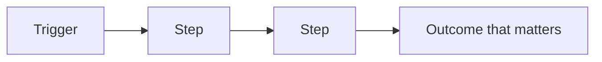
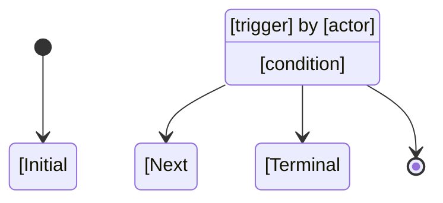

# [Product name] — What this system does

> Reconstructed from the codebase at [commit / date]. Analysis mode: [complete context / repository atlas]. This document describes observed behavior only; interpretive claims are labelled as synthesis. Inconsistencies and ambiguities found in the code are recorded as observations, not as questions for the reader to resolve.
> **Discovery boundary:** [Bounded contexts and products analyzed.] **Sampled or excluded:** [Areas intentionally not read and why — atlas mode only.] **Confidence limits:** [Missing tools, unavailable contracts, or facts that could not be established from the repository.]
> This document uses business language. Every rule and concept has an ID (`R-001`, `C-001`); the technical evidence for each ID lives in `TECHNICAL_DOMAIN_GUIDE.md`.

## Three things that would surprise a newcomer

[Up to three observed findings — drawn from the code, not inferred — that contradict what a reasonable reader would assume before opening the code. Each states what is surprising, why it is surprising, and references the evidence by rule ID. Use the same findings, in the same order and with the identical italic headline, as `TECHNICAL_DOMAIN_GUIDE.md`. Hard cap at three; longer lists become decoration. If the repository yields fewer surprising observations, list only those; in an absence report, the absence itself is the finding.]

*Example:*
1. *The "Confirm" button does not reserve the berth.* *It only places the booking in the harbourmaster's queue; no berth is held at that step.* (R-003)
2. *"Cancel" means two different things in the same flow.* *Skipper cancellations and weather closures share one event but lead to different follow-ups; the cancellation email currently treats them identically.* (R-011)
3. *A booking can be marked Checked In in the database even if the service-layer guard is bypassed.* *The service guard and the database constraint reject different transitions — either side can be patched without the other noticing.* (R-007)

## In one paragraph

[What the product does, for whom, and the problem it removes — only if the repository establishes these. Plain language, no technical terms. Do not state market size, customer counts, or commercial model unless the repository documents them. If someone reads only this paragraph, they should be able to describe the product in a meeting.]

*Example —* *Tidewater Marina is a booking platform that lets visiting skippers request berths and lets the harbourmaster confirm, check in, and close each stay. It centralizes berth availability and surfaces the bookings that need a human decision.*

## Who uses it

[Include human roles, automated actors (schedulers, consumers), and external systems that act on this product.]

| Actor | What they do here | What they cannot do |
|---|---|---|
| [Role] | [Their main actions] | [Meaningful restrictions] |

*Example —*
| *Visiting skipper* | *Requests berths, registers the boat, cancels stays.* | *Cannot choose a specific berth or change seasonal tariffs.* |
| *Harbourmaster* | *Confirms requests, assigns berths, checks boats in and out.* | *Cannot confirm a booking for a boat they own.* |
| *Nightly occupancy job* | *Compares checked-in boats with berth sensors and flags mismatches.* | *Cannot change booking state; it only raises inspection tasks.* |

## Concept index

[Every domain concept found, complete — this table is the coverage artifact. One line each; depth lives in the next section or in the per-context file.]

| ID | Concept | One-line meaning | Told in depth at |
|---|---|---|---|
| C-001 | [Concept] | [One-line meaning] | [§ The main concepts / domains/<context>.md] |

## The main concepts

The four to eight ideas that organize the product, chosen from the concept index. **Do not settle for a one-line definition per concept.** For each one, the section must be deep enough that a newcomer can answer four questions without rereading the code: *what is this thing, what does it look like in this product, what happens when it changes or disappears, and what would a newcomer get wrong without it?* If any of those four is missing, the subsection is not done.

Length here is not a constraint — depth is the deliverable. A glossary of one-liners belongs at the end of the document; this section is where the model gets built.

Cover for each concept:

- A definition grounded in observed behavior, not inferred intent.
- Its attributes and shape, using the terminology the code actually uses. If the UI, the docs, and the database use different names for the same thing, record all of them without deciding which is correct.
- Its relationships with the other concepts in this section, named specifically (one-to-many, belongs-to, triggers, blocks) — never "related to".
- The business processes it participates in, end to end, with the actors involved and the outcome of each participation. A process is not a CRUD operation; it is a workflow with a non-trivial business meaning.
- A short "why a newcomer must understand it" — the decisions a new joiner will make in their first weeks that pivot on this concept.

Use the code's observed terminology. If the interface and the implementation use different names, record both. If the codebase hides a concept the docs never name (a column, a status, a service that appears in no spec), surface it here anyway — its absence from the docs is a finding.

### [Concept]

**What it is.** [Definition based on observed behavior. State what a fresh instance looks like, what changes about it over time, and what happens if it disappears from the system. Do not state why it exists unless the repository explicitly documents that reason.]

**Attributes and shape.** [The fields, states, components, or invariants it carries. Use the names the code uses; if the UI or the business language uses different ones, record both. State units, ranges, and enums verbatim.]

**Relationships with other concepts.** [For each related concept, name the relationship specifically and what it means in business terms. Note which relationships are asymmetric, which are optional, and which the code enforces vs. merely implies.]

**Processes it participates in.** [For each process, name the actor, the trigger, and the outcome. If the concept has a lifecycle, describe each transition and who moves it forward; if it is passive, describe the events that read or write it.]

**Why a newcomer must understand it.** [What decisions a new joiner will make in their first weeks that depend on this concept, and what they will get wrong without the mental model. Frame this in business terms, not code terms.]

*Example — Booking.*

*What it is.* A skipper's request to moor one boat at the marina for a range of nights. Each Booking starts as a request, is confirmed by the harbourmaster, and ends either completed or cancelled. A cancelled Booking is never reopened — the skipper files a new request — so the lifecycle is forward-only with cancellation as a terminal state.

*Attributes and shape.* A status (Requested, Confirmed, Checked In, Completed, Cancelled), a boat, an arrival and departure date, a berth assigned on confirmation, a 24-hour confirmation window measured from the request, and the boat's length stored in centimetres and shown in metres in the UI. The status field drives nearly every branch in the system; "Cancelled" covers two distinct causes that downstream code treats differently (see § Terminology traps).

*Relationships with other concepts.* A Booking belongs to exactly one Boat and one Skipper. It has zero or one assigned Berth (mandatory once Confirmed; never swapped after Checked In). It owns zero or many HarbourLog entries — append-only records of who did what and when. On Completed, it generates exactly one Stay Charge. On Cancelled, it does not mutate further: a new Booking is requested instead, and the original is kept for audit.

*Processes it participates in.*

- *Request* — a Skipper files the Booking from the portal; the system starts the 24-hour confirmation clock.
- *Confirmation* — the Harbourmaster assigns a Berth and moves the Booking to Confirmed; missing the window flags the request but does not auto-decide.
- *Arrival* — on check-in, the Booking becomes Checked In and the berth is marked occupied.
- *Departure* — on check-out, the Booking is Completed and a Stay Charge is issued.
- *Audit* — every status transition writes a HarbourLog entry; the Booking is the root of the audit trail.

*Why a newcomer must understand it.* Berth availability, charges, notifications, and audit logs all branch on the Booking's status. New joiners should design features by asking first: "which Booking statuses does this apply to, and which must it never touch?"

## Process catalog

[Every material business process found, complete — this table is the coverage artifact for behavior. The highlighted journeys in the next section are chosen from here.]

| ID | Process | Actor | Trigger | Outcome | Told in depth at |
|---|---|---|---|---|---|
| P-001 | [Name] | [Who starts it] | [What starts it] | [What the business gets] | [§ How the value flows / domains/<context>.md] |

## How the value flows

[The two or three journeys that carry the product's value, narrated end to end. These are the orientation artifact — the complete list lives in the process catalog above.]

[Narrate the same flow in two or three sentences: what starts it, what has to be true along the way, what the business gets at the end. Include the failure and exception paths that change the outcome.]

## Lifecycles

[One subsection per entity that has a meaningful state — not one representative diagram. For each: what each state means for the business, who moves it forward, which transitions the system explicitly rejects, and which transitions simply have no code behind them (an absence, not a prohibition — say which).]

### Life of a [entity]

## The rules of the game

The conditions the system enforces, in business language. Each states what is required and what happens when it is not met. The ID is the link to the technical evidence.

| ID | Rule | Why it matters | What happens if broken |
|---|---|---|---|
| R-001 | [What must hold, in business language] | [Rationale, or "rationale not stated in the repository"] | [What the system does when it is not met] |

[When the repository does not state a rationale, write "rationale not stated in the repository" — do not invent one.]

## Where the observable value lives

[The one or two mechanisms this system implements that concentrate its differentiating logic — a calculation, an integration, accumulated data, a manual process it eliminates. Label each claim: *observed mechanism* (the code shows it), *synthesis* (your reading of the evidence), or *not established* (commercial value the repository cannot prove). Never state that "everything else exists to support this" as fact.]

*Example:* *The berth allocator matches boat length and draught against free berths, including ~40 berth-class exceptions (observed mechanism — R-014 through R-053). Whether this allocator is the reason marinas adopt the product is not established by the repository.*

## Vocabulary

| Term | Means | Also called |
|---|---|---|
| [Term] | [One-line definition] | [Alias in the interface or in the code] |

*Example:*
| *Booking* | *A skipper's request to moor one boat for a range of nights.* | *`Booking`, `berth_request`, "reservation" in older UI strings.* |
| *Harbourmaster* | *A marina employee authorized to confirm bookings and assign berths.* | *`harbour_staff`, "dockmaster" in legacy reports.* |

## Terminology traps

Cross-team vocabulary mismatches observed in the code. Each row names the trap, the two meanings, and the rule ID where the evidence lives. List only traps that have caused or could cause a wrong business decision — not minor synonyms.

| Code / UI term | Business meaning | Why it confuses | Evidence |
|---|---|---|---|
| [Term as it appears in code or UI] | [What the business actually means] | [The wrong assumption a newcomer would make] | [R-NNN / T-NNN] |

*Example:*
| *"Confirm" (button label)* | *"Send to the harbourmaster's queue"* | *The UI says "Confirm" but the action only queues the request — no berth is held yet.* | R-003 |
| *"Cancel" (in code)* | *"Skipper withdrew" or "marina closed for weather"* | *One event covers both causes; the downstream cancellation email treats them identically.* | R-011 |

## Related contexts

When the domain spans several bounded contexts, a per-context file is generated for each in `domains/`. This overview lists every one, and every per-context file's "Related contexts" links back here. Update both directions: omitting the link breaks navigation for the reader.

| Context | File | Relationship |
|---|---|---|
| [Name] | [`domains/<other>.md`](domains/<other>.md) | [Reads from / writes to / triggered by / …] |
| Code map | [`TECHNICAL_DOMAIN_GUIDE.md`](TECHNICAL_DOMAIN_GUIDE.md) | The evidence for every rule and concept ID used in this document lives there. |

If the product has only one context, replace this section with: *"This product is a single bounded context; no per-context files are produced."*

## What the code does not establish

Record only missing evidence, such as an external contract, an undocumented rationale, or an actor not represented in the repository. Do not ask the reader to reconcile inconsistencies found in the code; describe those inconsistencies in the relevant section above with their rule IDs. Reference each missing fact by the `F-` ID defined in `TECHNICAL_DOMAIN_GUIDE.md § Information absent from the repository`.

*Example:*
1. *(F-001) Who sets the seasonal berth tariffs — the marina operator or the port authority? The system reads the tariffs from configuration but nothing identifies the owner or the update cadence.*
2. *(F-002) What happens to a confirmed berth when a weather closure lasts beyond three days? The system flags the booking but does not record what the marina then owes the skipper.*
