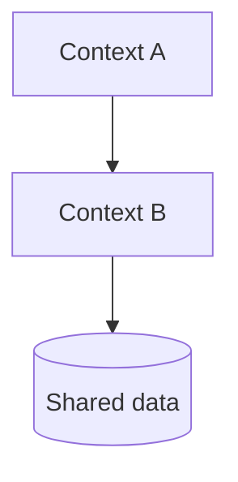
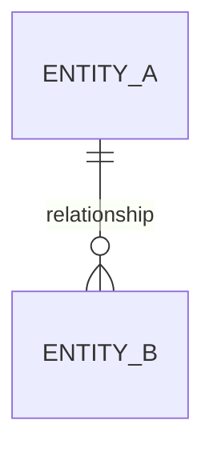
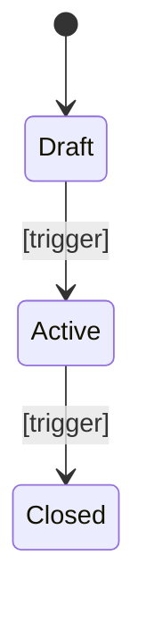

# [Product name] — Technical domain guide

> Reconstructed from the codebase at [commit / date]. Analysis mode: [complete context / repository atlas]. This guide describes observed behavior only.
> References point to `path/to/file.ext:line` as of that revision. Do not infer expected behavior or propose corrections. Record inconsistencies, contradictions, and ambiguities as observations with their evidence.
> Every rule, concept, process, and term carries a stable ID (`R-001`, `C-001`, `P-001`, `T-001`); `BUSINESS_OVERVIEW.md` and the per-context files reference those IDs, and this guide is where their evidence lives.

## Orientation

[Two or three sentences: what the system does, what shape it is (single service, monorepo, modular monolith), and where the business logic actually lives versus where it merely passes through.]

*Example:* *Acme Claims is a modular monolith with three deployables (portal, API, worker). The pricing logic lives entirely in `src/pricing/`; the rest is request routing, persistence, and presentation.*

**Discovery boundary:** [Contexts and deployables analyzed.] **Sampled or excluded:** [Areas intentionally not read and why.] **Confidence limits:** [Missing tools, unavailable contracts, conflicting evidence, or recommended next context.]

## Coverage matrix

[The denominator of completeness — one row per surface per context, from the ledger's coverage inventory. Statuses: `complete` / `partial` / `blocked` / `not-found-after-search` / `not-applicable` / `out-of-scope`. In complete context mode every row must be `complete`, `not-found-after-search`, or `not-applicable`. In atlas mode, every `partial`, `blocked`, or `out-of-scope` row must say what remains and how a second pass continues.]

| Context | Surface | Artifacts found | Reviewed | Excluded | Status | Note |
|---|---|---|---|---|---|---|
| [Name] | [routes / jobs / tables / …] | [n] | [n] | [n] | [status] | [what remains, if anything] |

## Three things that would surprise a newcomer

[Three observed findings — drawn from the code, not inferred — that contradict what a reasonable reader would assume before opening the code. Hard cap at three. Same findings appear in `BUSINESS_OVERVIEW.md § Three things that would surprise a newcomer` in business language.]

*Example:*
1. *The "Paid" transition is guarded twice with different rules.* *`src/claims/service.py:142` allows `Submitted → Rejected`; `migrations/0042.sql:18` does not. Either side can be patched without the other noticing.* — `src/claims/service.py:142`, `migrations/0042.sql:18`
2. *Pricing logic is duplicated in two places that diverge on rounding.* *`src/pricing/engine.py` uses banker's rounding; `src/payments/calculator.py` rounds half-up. There is no shared helper.* — `src/pricing/engine.py:201`, `src/payments/calculator.py:88`
3. *The legacy `legacy_submit()` function has no callers.* *It is imported by a module whose own callers were removed; runtime status: unreachable.* — `src/claims/actions.py:204`

## Read these first

**Read these first:** `path/a.ext`, `path/b.ext`, `path/c.ext` — the three files that explain the most about the domain.

**Start here for the actual task** — domain-focused action entries. Point a contributor at the right place for what they came to change:

- *Changing a rule in `<area>`:* start at `<path:line>`; tests in `<path>`. Do not change `<path:line>` without reading the other enforcement layers listed under rule R-NNN.
- *Onboarding for the long haul:* read Orientation, then the coverage matrix, then the Domain map, then the Invariants section for the module you will own.

[Operational entries — deploying, on-call, owners — are optional: include them only when the repository actually documents them (runbooks, CI files, CODEOWNERS). Never invent teams, dashboards, or incident history.]

## Domain map

| Bounded context / module | Path | Owns | Depends on |
|---|---|---|---|
| [Name] | `src/...` | [Concepts it is authoritative for] | [Other contexts] |

[A grouping earns "bounded context" status when it has its own vocabulary, its own authority over its data, and translation at its edges — not merely because it is a folder or a deployable. Where the boundary is only technical, say so.]

[Where the boundaries are clean and where they leak. Describe leaks as observed relationships or conflicting behavior, with evidence; do not infer which boundary is correct.]

## Model

| ID | Entity | Defined at | Identity | Notes |
|---|---|---|---|---|
| C-001 | [Name] | `path:line` | [Natural or surrogate key] | [Aggregate root, value object, lifecycle owner] |

*Example:*
| C-001 | *Claim* | *`src/claims/models.py:21`* | *Surrogate (`claim_id`); natural key is `(hospital_id, insurer_ref)`* | *Aggregate root; owns its Review and Payment rows.* |

## Lifecycles

[One subsection per entity that has a meaningful state. For each: the diagram, the transition table, and two explicit lists — transitions the system *rejects* (a guard or constraint fires) and transitions with *no code behind them* (absence, not prohibition).]

### Life of a [entity]

| Transition | Enforced at | Guard | On violation |
|---|---|---|---|
| Draft → Active | `path:line` | [Condition] | [Error raised / behaviour] |

*Example:*
| *Submitted → In Review* | *`src/claims/service.py:142`* | *`reviewer_id is not None`* | *Raises `NoReviewerAssigned`; the API returns 409.* |
| *In Review → Paid* | *`src/claims/service.py:198`, `migrations/0042.sql:18`* | *Both the service-level guard and the DB CHECK* | *Service raises `PaymentBeforeReview` (422); DB rejects the UPDATE if the guard is bypassed.* |

Transitions explicitly rejected: [guards/constraints that fire].
Transitions with no observed code: [absences — no enforcement found either way].

## Process inventory

[Every operation from the coverage inventory, traced end to end. State: `traced` / `passthrough` / `out-of-scope` / `blocked`. Passthrough means confirmed to carry no decision logic — say what you checked.]

| ID | Operation | Entry point | Use case | Side effects | State | Evidence |
|---|---|---|---|---|---|---|
| P-001 | [Name] | [route / job / consumer / handler] | `path:line` | [persistence, events, integrations] | [state] | `path:line` |

## Invariants and business rules

Grouped by concept. Each rule gets a stable ID, its evidence, and four separate axes — never collapse them into one confidence label:

- **Evidence confidence** — `direct`: the code or docs state it. `corroborated`: two independent artifacts agree. `indirect`: inferred from naming or shape. Surface `indirect` rules explicitly so reviewers do not over-trust them.
- **Enforcement** — where the rule is enforced: `db`, `domain`, `application`, `edge`, `docs-only`, `none`. A rule enforced at one layer is not less certain; it is less defended.
- **Consistency** — `consistent` / `divergent` / `unknown` across layers.
- **Runtime status** — `active` / `config-dependent` / `inactive` / `test-only` / `unreachable` / `unknown`.

### [Concept]

| ID | Rule | Evidence | Confidence | Enforcement | Consistency | Runtime | Failure mode | Rationale |
|---|---|---|---|---|---|---|---|---|
| R-001 | [What must hold] | `path:line` | [direct / corroborated / indirect] | [db / domain / …] | [consistent / divergent / unknown] | [active / …] | [Exception, HTTP status, silent fallback] | [Documented rationale / not stated in repository] |

*Example:*
| R-007 | *A claim cannot move to Paid without a reviewer_id* | *`src/claims/service.py:198`, `migrations/0042.sql:18`* | *direct* | *domain + db* | *divergent (the two layers reject different transitions)* | *active* | *Service raises `PaymentBeforeReview`; DB CHECK rejects the row UPDATE.* | *Stated in `docs/policies/audit.md:4`.* |
| R-009 | *A reviewer cannot approve claims from their own hospital* | *`src/accounts/policy.py:71`* | *direct* | *application* | *unknown (nothing in the DB layer re-checks this)* | *active* | *API returns 403.* | *Not stated in the repository.* |

## Policies, constants and calculations

| ID | What | Value | Location | Configurable | Kind |
|---|---|---|---|---|---|
| R-020 | [Threshold, rate, window] | [Value] | `path:line` | [Yes / hardcoded] | [domain rule / application constraint / technical / unknown] |

[Calculation logic worth understanding before touching it: rounding, precision, ordering of operations, currency handling. Describe what is implemented, including divergent implementations, without selecting an intended one. Not every number is a business rule — use the Kind column and say `unknown` when the repository does not say.]

## Permissions and visibility

| ID | Actor | Can | Enforced at |
|---|---|---|---|
| A-001 | [Role] | [Operations] | `path:line` |

[Tenant or organization scoping: how it is applied, and where it could be forgotten. Include automated actors — jobs and consumers — with the operations they perform.]

## Time-driven behaviour

| Job / trigger | Schedule | Business effect | Location |
|---|---|---|---|
| [Name] | [Cron or event] | [What changes in the business] | `path:line` |

## External contracts

| System | Direction | Purpose | Adapter |
|---|---|---|---|
| [Name] | inbound / outbound | [Business role] | `path:line` |

[For each: what breaks in business terms when it is unavailable, and what the repository does not show — authentication, versioning, payload mapping, rate limits. Webhook handlers list the events the outside world can impose on this business.]

## Where the value lives, technically

[The modules that concentrate the differentiating logic, with evidence — this is where reviews should be strictest and test coverage highest. Label the claim: observed mechanism (code shows concentration) vs synthesis (your reading of why it matters). Commercial value the repository cannot prove belongs in § Information absent from the repository.]

## Risks and observations

Things a newcomer should know before their first change. Facts and their direct consequences, not opinions about style or guesses about intended behavior. Tag each observation with a severity so readers can triage: *BLOCKER* (rule enforced in two layers that can diverge — fix before changing either side), *RISK* (hardcoded threshold, magic number, business logic in a migration — review carefully), *SMELL* (dead branch, naming confusion, observation without immediate action).

- **BLOCKER — [Observation]** — `path:line`. [Why it is a blocker: rule enforced in two layers that can diverge, etc.]
- **RISK — [Observation]** — `path:line`. [Why it is a risk: hardcoded threshold, unbounded query, business logic in a migration, etc.]
- **SMELL — [Observation]** — `path:line`. [Why it is a smell: dead branch, naming confusion, etc.]

*Example:*

- **BLOCKER — Claim status transitions are guarded in two places** — `src/claims/service.py:142` and `migrations/0042.sql:18`. The Python guard allows `Submitted → Rejected`; the DB constraint does not. Either side can be patched without the other noticing.
- **RISK — Insurer fee schedules are committed as JSON in the repo** — `config/fees/insurer-acme.json:1`. A change requires a full deploy; there is no admin UI or feature flag.
- **SMELL — `legacy_submit()` in `src/claims/actions.py:204` has no callers** — unreachable in the current codebase.

### Terminology traps

Naming mismatches between the code and the business. Each row names the trap, the two meanings, and where it shows up. List only traps that have caused or could cause a wrong business decision — not minor synonyms. Cross-reference `BUSINESS_OVERVIEW.md § Terminology traps` for the same entries in business language.

| ID | Code / UI term | Business meaning | Why it confuses | Defined at |
|---|---|---|---|---|
| T-001 | [Term as it appears] | [What the business actually means] | [The wrong assumption] | `path:line` |

## Glossary (code ↔ business)

| ID | Code term | Business term | Defined at | Note |
|---|---|---|---|---|
| T-001 | `[Identifier]` | [Business word] | `path:line` | [Synonym, homonym, or legacy naming] |

*Example:*
| T-007 | *`payout_amount_cents`* | *Net payout* | *`src/payments/models.py:33`* | *Field stored in cents; UI shows dollars. Watch for off-by-100 bugs when reading the value back.* |

## Related contexts

When the domain spans several bounded contexts, a per-context file is generated for each in `domains/`. This guide lists every one, and every per-context file's "Related contexts" links back here. Update both directions: omitting the link breaks navigation for the reader.

| Context | File | Relationship |
|---|---|---|
| [Name] | [`domains/<other>.md`](domains/<other>.md) | [Reads from / writes to / triggered by / …] |
| Business overview | [`BUSINESS_OVERVIEW.md`](BUSINESS_OVERVIEW.md) | Per-context files cross-link here for product-wide rules and the "Three things that would surprise a newcomer". |

If the product has only one context, replace this section with: *"This product is a single bounded context; no per-context files are produced."*

## Information absent from the repository

List only facts that cannot be established from the repository, such as invisible external contracts or undocumented rationale. Do not ask a human to resolve an observed inconsistency; record the competing behaviors in the relevant sections above.

1. **[Missing fact]** — [Evidence showing that the repository does not establish it: `path:line`.]

*Example:*
1. *Who negotiates the per-insurer fee schedule — product or finance? The code reads schedules from `config/fees/` but nothing in the repository identifies the owner or the cadence.*
2. *What is the contractual SLA with each insurer after the 48h internal review window expires? The code escalates to a human but does not record what the insurer is then obligated to do.*
